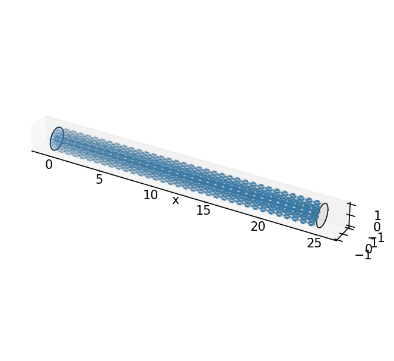
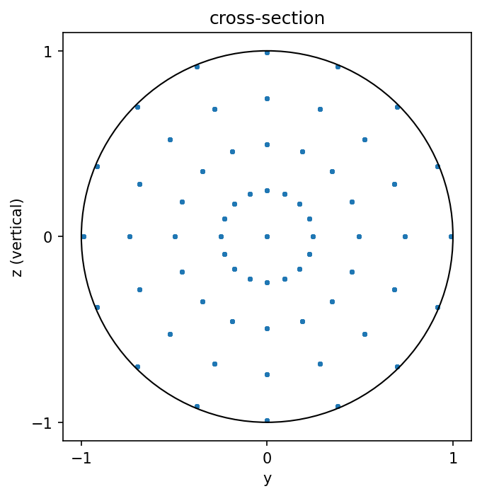
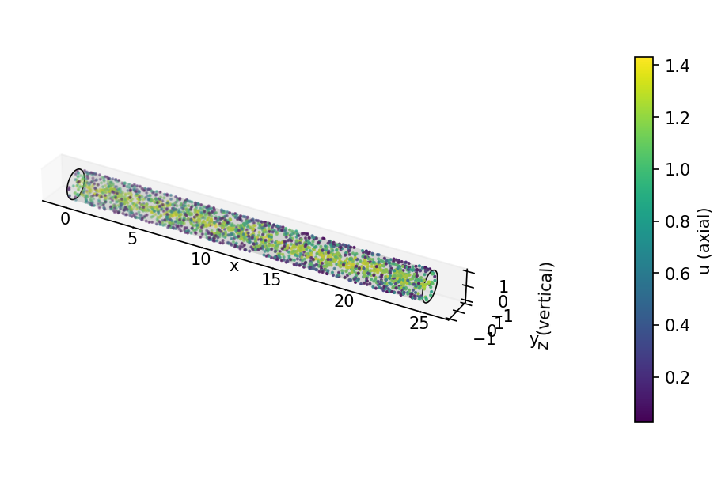
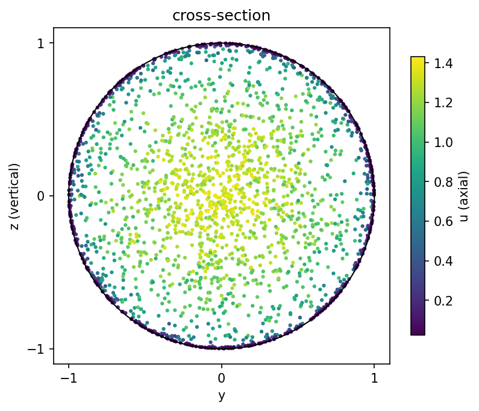

# Pipeflow at Re_b=5300 and Re_tau = 180, with lagrangian particle tracking with particle Stokes number 50.

## running
0. Compile turb_pipe.f90 for an neko executable;
1. First run particle_generator.py to generate the initial condition for the particles in a csv file;
2. Run the case with particle stored as csv files;
3. Use particle_plot.py to plot the particle distribution

## Note
1. particle_generator.py is written for helical pipes, however, by setting the curvature and torsion to be 0, a straight pipe could be adapted for.

## expected results
For the current setting, the particle start from the following state:

  
  

With time progression, the particle field looks like:

  
  

